# Fault-Tolerant Replicated Key–Value Service

A small distributed key–value service built to demonstrate **fault tolerance, replication, and consistency**. Three independent Python processes coordinate using a Raft-style protocol: one node leads, writes are replicated to a majority, and the remaining replicas elect a new leader if the current leader fails.

> **Course project:** Distributed Systems  
> **Implementation:** Python 3 standard library  
> **Cluster size:** Three replicas

## Contents

- [Overview](#overview)
- [Key features](#key-features)
- [Architecture](#architecture)
- [Requirements](#requirements)
- [Run the service](#run-the-service)
- [Use the API](#use-the-api)
- [Test fault tolerance](#test-fault-tolerance)
- [Project structure](#project-structure)
- [Screenshots](#screenshots)
- [Limitations](#limitations)
- [References](#references)

## Overview

The service stores string keys and JSON values across three local replica processes. A leader accepts writes, appends each operation to its log, and acknowledges it only after a majority has replicated it. Replicas persist their state to JSON files so committed values can be recovered after a process restarts.

The included web dashboard displays the status of each replica, the elected leader, the commit index, and the committed key–value state. It also provides a simple form for submitting writes.

## Key features

- **Leader election:** replicas elect a leader when the current leader is unavailable.
- **Replicated writes:** log entries are sent from the leader to the other replicas.
- **Majority commit:** a write is acknowledged only after a majority has stored it.
- **Crash tolerance:** with three replicas, the service can continue accepting writes after one replica fails.
- **Persistent recovery:** a restarted replica reloads its saved state and catches up with committed entries.
- **Follower redirection:** writes sent to a follower are rejected with a leader hint.
- **Live dashboard:** inspect replica roles and try writes in a browser.

## Architecture

```text
                    HTTP clients / Dashboard
                              |
                    elected leader replica
                     /                 \
              AppendEntries         AppendEntries
                  /                       \
          follower replica           follower replica
```

Each process runs an HTTP server and maintains its own term, vote, replicated log, commit index, and key–value state. The leader sends heartbeats and log entries to its peers. Elections use randomized timeouts; voting checks candidate log freshness. A write is considered committed when the leader confirms replication to a majority.

## Requirements

- Python 3.9 or later
- macOS, Linux, or another environment that supports Python and local TCP connections
- Ports `8001`, `8002`, and `8003` available

The service uses only the Python standard library; no package installation is required.

## Run the service

From the project root, run:

```sh
sh start_cluster.sh
```

The script starts all three replicas. It supports the `src/fault_tolerance_replication_consistency_ds/node.py` layout. Running it through `sh` also works if the executable permission was lost when copying the project.

Wait a few seconds for an election, then open [http://127.0.0.1:8001](http://127.0.0.1:8001). The dashboard polls all three replicas and displays the current leader.

Keep the cluster terminal open while using the service. Press **Control+C** in that terminal to stop the cluster.

## Use the API

Check a replica's health and role:

```sh
curl http://127.0.0.1:8001/health
```

Write a key–value pair to the current leader (replace the port if another replica is leader):

```sh
curl -X POST http://127.0.0.1:8001/kv \
  -H 'Content-Type: application/json' \
  -d '{"key":"course","value":"MIT 6.5840"}'
```

Read the replicated state from a replica:

```sh
curl http://127.0.0.1:8002/kv/course
```

Delete a key by sending the request to the leader:

```sh
curl -X POST http://127.0.0.1:8001/kv/delete/course
```

A successful write response includes its log index, term, and replica count. A follower returns HTTP `409` with a leader hint. If a majority is unavailable, the write cannot be committed and returns an error.

## Test fault tolerance

Run the automated end-to-end test from a second terminal in the project root:

```sh
python3 tests/test_cluster.py
```

The test launches an isolated three-process cluster and checks leader election, majority replication, follower write rejection, leader failure, reelection, continued writes, and recovery of the restarted replica. A passing run prints a `PASS` summary.

To demonstrate failover manually while the main cluster is running:

1. Check the three `/health` endpoints and identify the leader:

   ```sh
   for p in 8001 8002 8003; do curl -s "http://127.0.0.1:$p/health"; echo; done
   ```

2. Stop the leader process. For example, if node 1 (port `8001`) is leader:

   ```sh
   kill $(lsof -tiTCP:8001 -sTCP:LISTEN)
   ```

   Use the matching port for node 2 or node 3 if one of them is leader.

3. Watch the dashboard or query the remaining replicas. One should become leader after an election.
4. Submit another write. With two of three replicas available, it should still be committed.
5. Restart the stopped replica using the same launch arguments and data directory to observe it catch up.

## Project structure

```text
.
├── src/
│   └── fault_tolerance_replication_consistency_ds
|       |__ node.py                                   # Replica server, Raft-style protocol, HTTP API, dashboard
├── data/                                             # Persistent JSON state created when the cluster runs
├── results/                                          # Place screenshots here                 
├── tests/
│   └── test_cluster.py                               # Automated failover and recovery test
├── README.md
└── start_cluster.sh                                  # Starts the three local replica processes
```

## Results

### Running cluster dashboard
**cluster 1 (http://127.0.0.1:8001)**
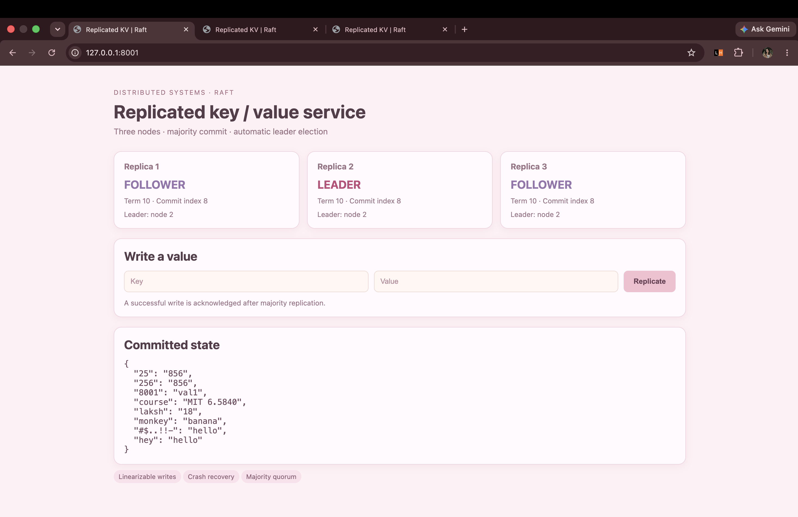

**cluster 2 (http://127.0.0.1:8002)**
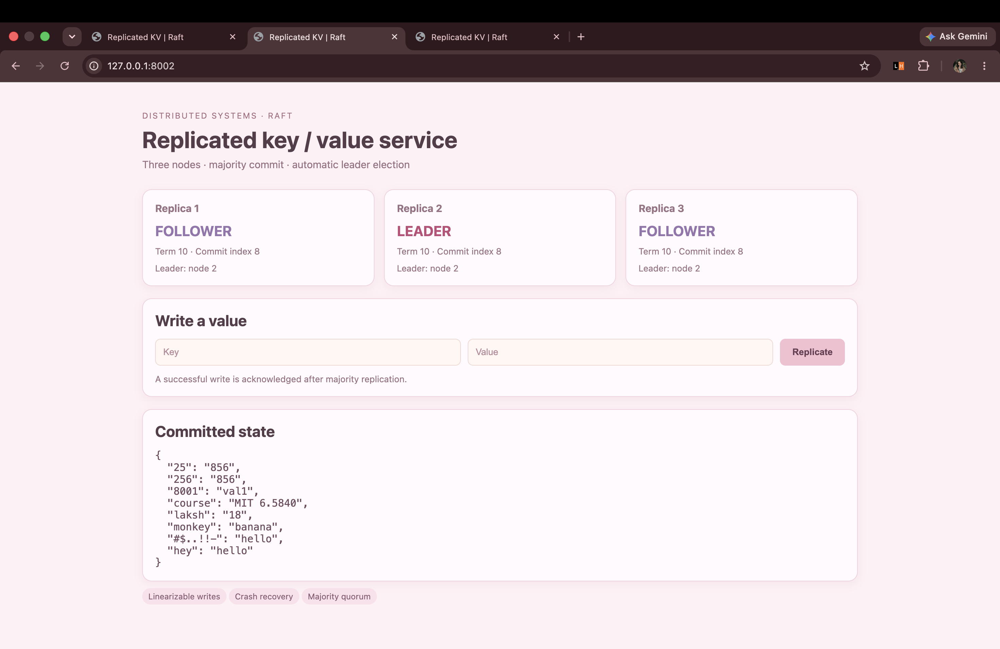

**cluster 3 (http://127.0.0.1:8003)**
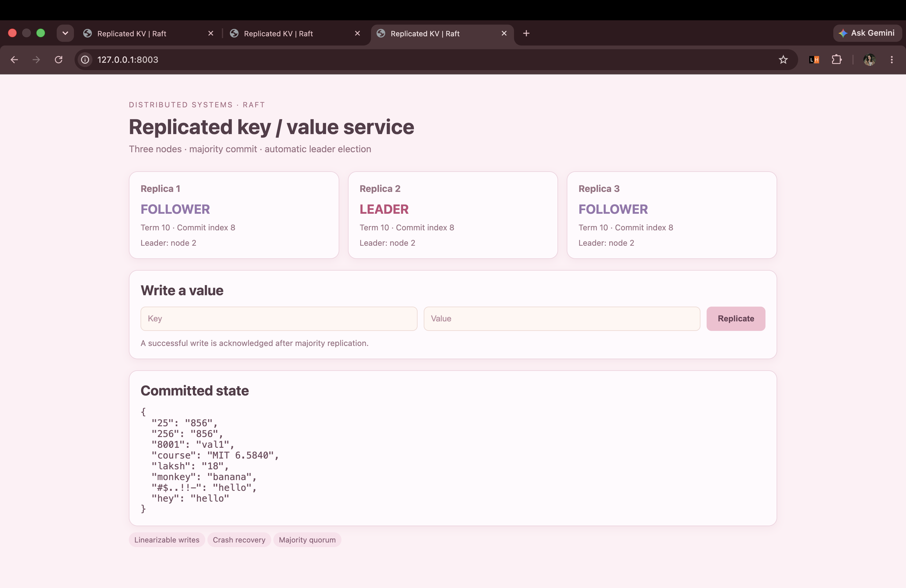


### Adding key-value pair
**adding kv pair in cluster3**
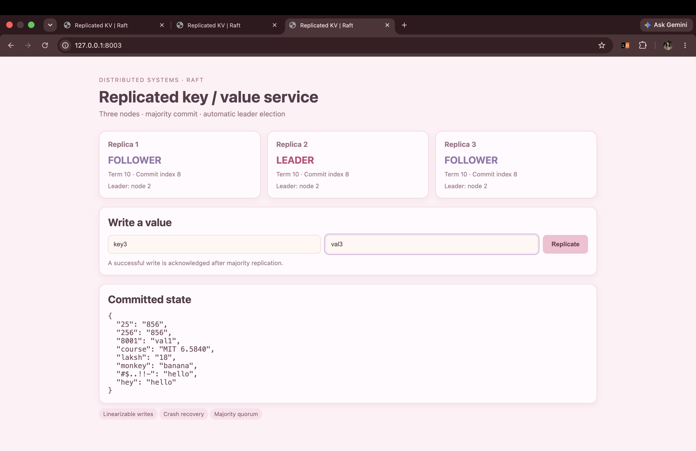

**cluster 1 after addition of kv pair**
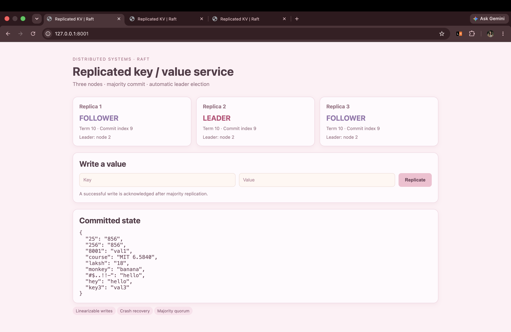

**cluster 2 after addition of kv pair**
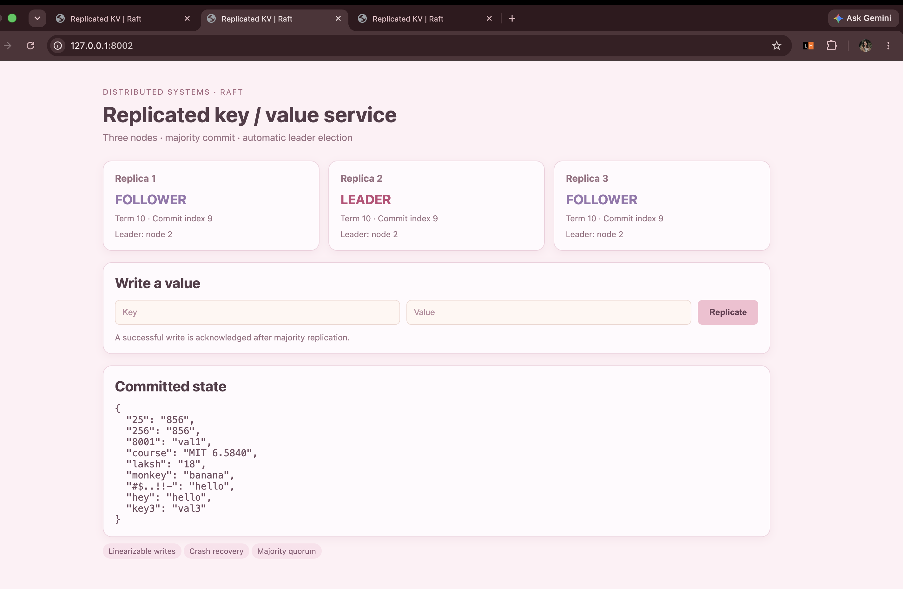

**cluster 3 after addition of kv pair**


### Leader failover and automated test results
**fault tolerance before any cluster goes down**
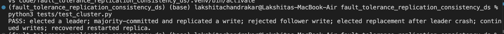

**status before any cluster goes down**
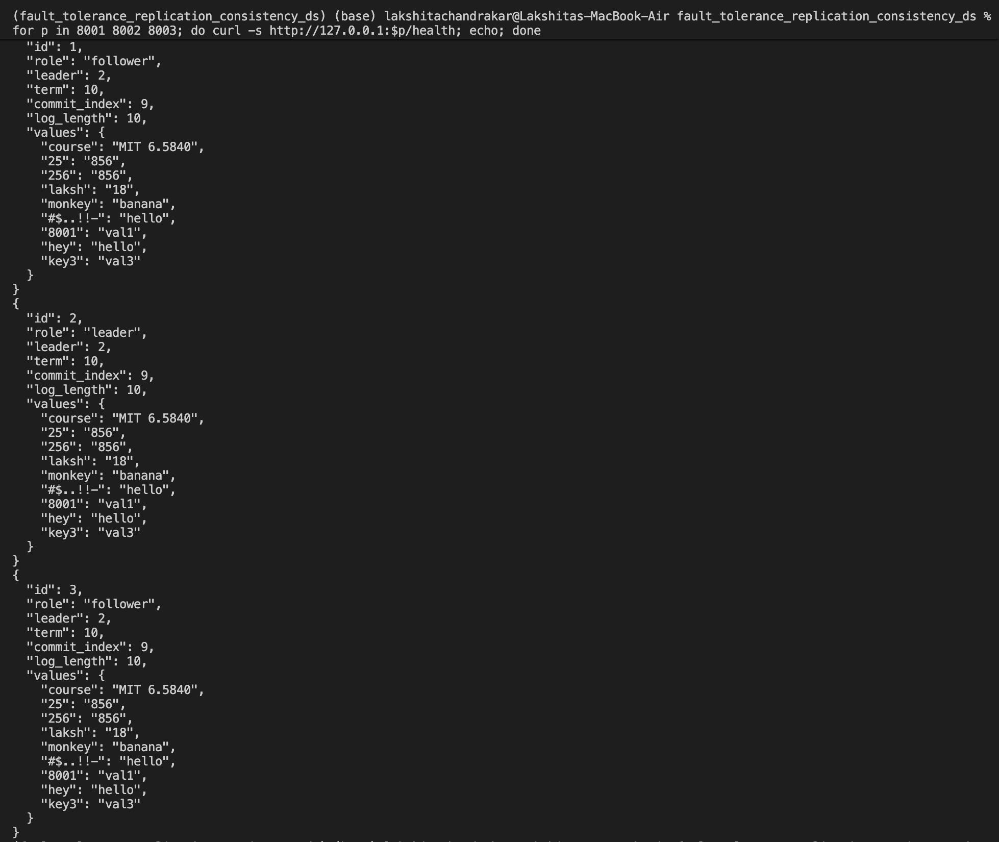

**killing the leader**
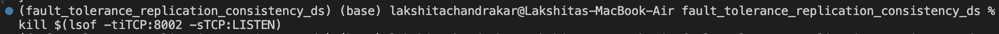

**cluster 1 after the leader is killed**
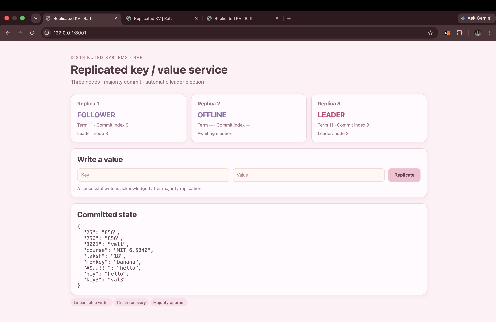

**cluster 2 after the leader is killed**


**cluster 3 after the leader is killed**
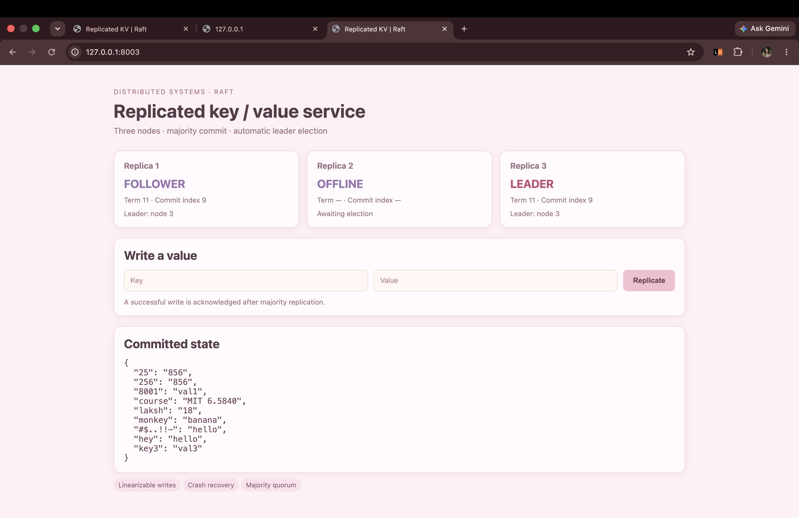

**status after the leader is killed**
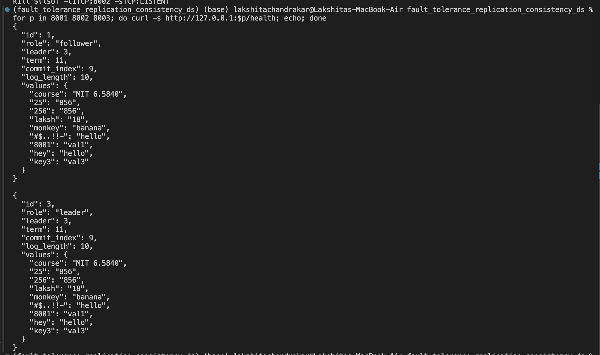

## Limitations

This is a compact educational implementation inspired by Raft concepts. It is intended for local demonstrations and coursework, not production deployment. It does not implement log snapshots or compaction, dynamic membership changes, authentication, TLS, or production-grade operational safeguards. Reads are served by the contacted replica; query the leader when you need the freshest committed state.

## References

- [MIT 6.5840 course schedule and study material](https://pdos.csail.mit.edu/6.824/schedule.html)
- [timyiu478/mit-distributed-systems](https://github.com/timyiu478/mit-distributed-systems)
- [zhou-yuhan/MIT-6.824-Distributed-Systems](https://github.com/zhou-yuhan/MIT-6.824-Distributed-Systems)
- [GaryHo34/MIT-6.5840-distributed-systems-labs](https://github.com/GaryHo34/MIT-6.5840-distributed-systems-labs)
